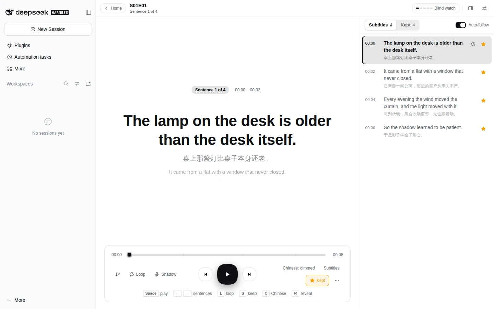

# dsh-lingualab

English | [简体中文](README.zh.md)

The LinguaLab panel is **one row in the left rail's 「更多」 menu, opening a whole page in the centre column**, leaving the current Session untouched. It turns media that already sits in the workspace into intensive-listening practice: one episode at a time, sentence by sentence, with the notes written back to disk where the agent can read them.



## Install

Requires a DeepSeek Harness install with a Web profile, and Node 22.19 or newer. `ffmpeg` and `ffprobe` are only needed to prepare video episodes.

```sh
dsh plugin --profile web add dsh-lingualab
```

Replace `web` with your own profile name. To pin a version:

```sh
dsh plugin --profile web add dsh-lingualab@0.21.3
```

Then open the left rail's 「更多」 menu and pick **LinguaLab**. Drop an audio file and its subtitles onto the page to start.

> **Usage statistics are off by default.** Turning them on sends one pseudonymous ping a day to `t.hi-ruofei.com`; see [Anonymous usage statistics](#anonymous-usage-statistics) for the exact payload and how to switch it on.

## What it does

- The **home** offers the episode to resume, the rest of the library and a drop target. Opening an episode switches to **practice**, and the back button returns home.
- **Adding material is dropping it.** Audio, video and subtitles pair by file name; several episodes can arrive together, and existing files are never overwritten. An empty library is just the drop target.
- One folder is one episode, and several audio files in it become segments. Video can supply a segment's picture and sound, with direct playback, one-time preparation and a lower-bandwidth smooth version; a local file can play without an upload.
- Practice works sentence by sentence, with speed, looping, subtitles, shadowing, recording and saved progress. Stars collect sentences for graded review, and notes stay on disk for the agent.


See [Usage](docs/usage.md) for the library layout, pairing rules, video formats and preparation settings, every practice control, notes, review and settings.

## Status

Both halves are written. The host provides the library scan, import route, media routes with `Range` support, browsable picker, notes read/write path and review list; the client provides the home, practice view, kept-sentences column and review, plus the browsing and media-folder layers.

The page has **no rail row of its own**, and no card on the 「应用」 page either. It is registered as a `main` panel under the key `lingualab`, and the entry is the first row of the left rail's 「更多」 menu. This plugin registers that row into `sidebar.panellist.actions` itself, and selecting it calls `layout.selectPanel('lingualab')`. The rail still does not grow a row per plugin, and the entry now belongs to the plugin, so it no longer depends on `dsh-apps-panel` being installed.

It is developed on `development` and released by pulling into `main`, which tags the version and publishes it to npm.

## Documentation

| Doc | What it covers |
|---|---|
| [Usage](docs/usage.md) | The home, adding material, episodes and segments, video, practice, notes and review, settings |
| [Anonymous usage statistics](docs/telemetry.md) | What the daily ping contains, what it never contains, how to turn it off |
| [Releasing](docs/releasing.md) | `ship`, the pull request into `main`, the tag, `deploy` |
| [Host routes](docs/host-routes.md) | Every route the host registers and what it answers |
| [Repository layout](docs/repository-layout.md) | What lives in each directory |


## Design

The layout, colours and interaction of the home, the practice view and the notes and steps drawers are drafted in Figma: [LinguaLab redesign](https://www.figma.com/design/kdmcHGX1TcLPj84v7rg1xY). The frames are `Practice / Light` and `Practice / Dark`, `Home / Light` and `Home / Dark`, `Notes / Light` and `Five steps / Light`.

The file is the reference for proportions and hierarchy, not for values: it hardcodes hex colours and the Inter font, while the page reads the host's `--dsw-alias-*` tokens and font so it follows the theme. A theme chosen in the settings overrides those same tokens on the page's root element and nowhere else.

On a narrow screen the right column becomes a drawer over the stage instead of a column beside it:


## Anonymous usage statistics

The ping is **off by default**. When it is on, each running host process sends at most one ping a day, only after the host has admitted a request; nothing is sent at start or when the ping is off.
It sends only the payload version, package name and version, a random install id, the Node major version, OS and architecture, an episode-count bucket and whether `ffmpeg` is available.
It **never** sends file names, folder paths, episode titles, notes, subtitles, user names, email, tokens, session ids, host names or IP addresses.
To turn it on, set `telemetry` to `true` in the plugin's profile entry (the Plugins page or `cordis.patch.yml`). While it is off, no id is generated, the library is not listed and no request is made.
See [Anonymous usage statistics](docs/telemetry.md) for the complete payload, delivery behavior and install-id rules.

## License

MIT — see [LICENSE](LICENSE).
