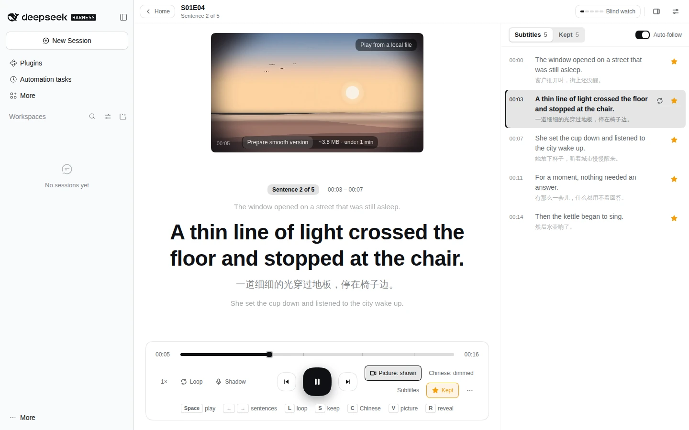
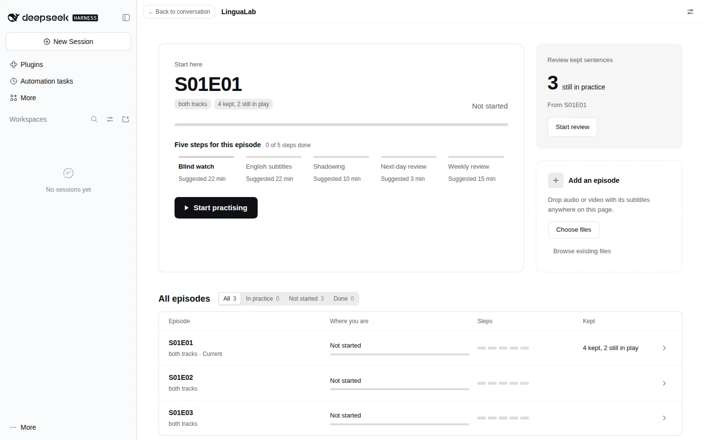
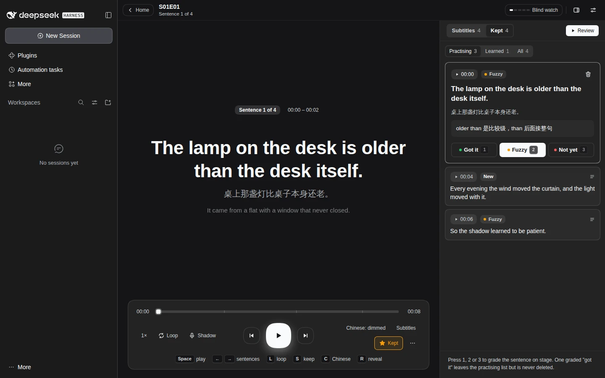

# dsh-lingualab

English | [简体中文](README.zh.md)

The LinguaLab panel is **one row in the left rail's 「更多」 menu, opening a whole page in the centre column**, leaving the current Session untouched. It turns media that already sits in the workspace into intensive-listening practice: one episode at a time, sentence by sentence, with the notes written back to disk where the agent can read them.


## Install

Requires a DeepSeek Harness install with a Web profile, and Node 22.19 or newer. `ffmpeg` and `ffprobe` are only needed to prepare video episodes.

```sh
dsh plugin --profile web add dsh-lingualab
```

Replace `web` with your own profile name. To pin a version:

```sh
dsh plugin --profile web add dsh-lingualab@0.21.3
```

Then open the left rail's 「更多」 menu and pick **LinguaLab**. Drop an audio file and its subtitles onto the page to start.

> **Usage statistics are off by default.** Turning them on sends at most one pseudonymous ping a day to `t.hi-ruofei.com`; the payload, how to switch it on and the rules are in [Anonymous usage statistics](docs/telemetry.md).

## What it does

- The **home** offers the episode to resume, the rest of the library and a drop target. Opening an episode switches to **practice**, and the back button returns home.
- **Adding material is dropping it.** Audio, video and subtitles pair by file name; several episodes can arrive together, and existing files are never overwritten. An empty library is just the drop target.
- One folder is one episode, and several audio files in it become segments. Video can supply a segment's picture and sound, with direct playback, one-time preparation and a lower-bandwidth smooth version; a local file can play without an upload.
- Practice works sentence by sentence, with speed, looping, subtitles, shadowing, recording and saved progress. Stars collect sentences for graded review, and notes stay on disk for the agent.

A video episode plays its picture above the sentence, under the same practice controls:





See [Usage](docs/usage.md) for the library layout, pairing rules, video formats and preparation settings, every practice control, notes, review and settings.

## Documentation

| Doc | What it covers |
|---|---|
| [Usage](docs/usage.md) | The home, adding material, episodes and segments, video, practice, notes and review, settings |
| [Design](docs/design.md) | The Figma reference, the host's colour tokens and themes, the right column as a drawer on a narrow screen |
| [Status](docs/status.md) | What the host and the client each provide, how the page is registered, how a change reaches a release |
| [Anonymous usage statistics](docs/telemetry.md) | What the daily ping contains, what it never contains, how to turn it off |
| [Releasing](docs/releasing.md) | `ship`, the pull request into `main`, the tag, `deploy` |
| [Host routes](docs/host-routes.md) | Every route the host registers and what it answers |
| [Repository layout](docs/repository-layout.md) | What lives in each directory |



## License

MIT — see [LICENSE](LICENSE).
