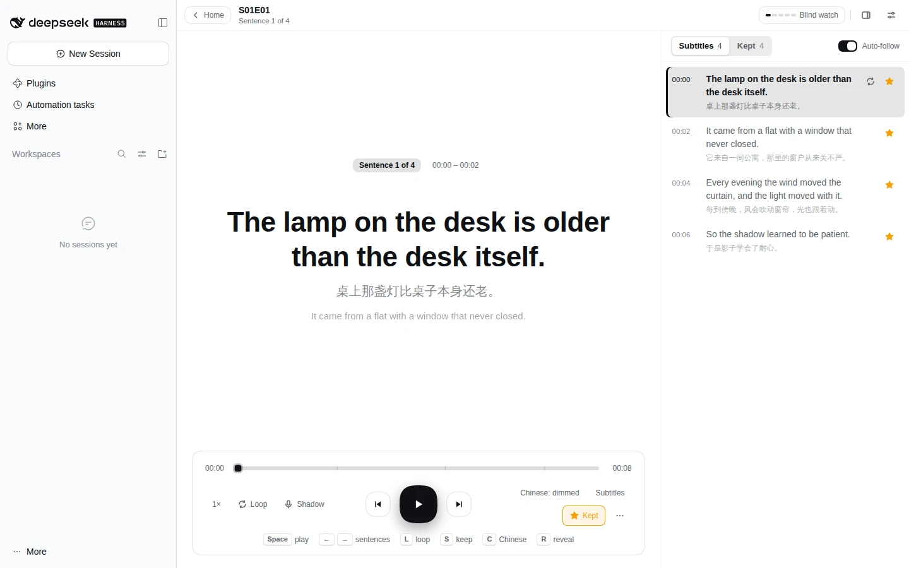
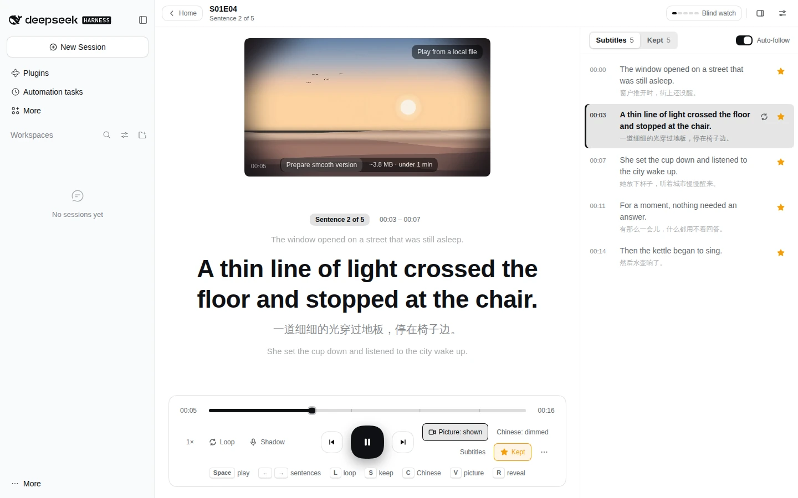
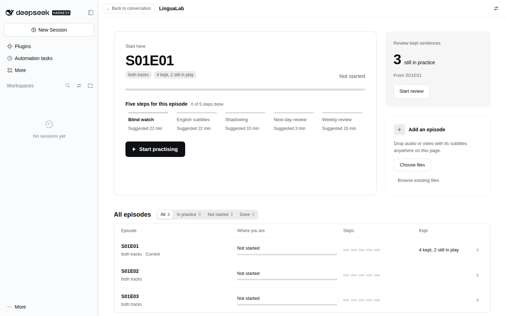
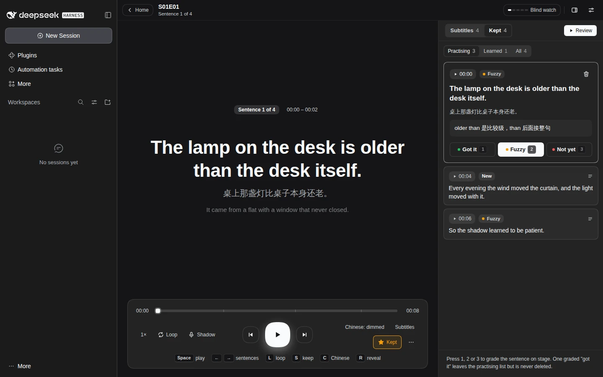

# dsh-lingualab

[English](README.md) | 简体中文

LinguaLab 是 DeepSeek Harness 的一个面板插件：入口在左栏「更多」菜单里，点开就在中栏展开一整页，当前会话不受影响。这一页把工作区里现成的音视频素材变成精听练习，一集一集地练，一句一句地过；笔记写回磁盘，Agent 也能直接读。



## 安装

需要先装好 DeepSeek Harness，准备好一个 Web profile，并使用 Node 22.19 或更高版本。只有准备视频剧集时才需要 `ffmpeg` 和 `ffprobe`。

```sh
dsh plugin --profile web add dsh-lingualab
```

把 `web` 换成你自己的 profile 名。要固定版本：

```sh
dsh plugin --profile web add dsh-lingualab@0.21.3
```

装好之后，从左栏「更多」菜单里点 **LinguaLab**，再把音频和字幕拖到页面上就能开始。

> **使用统计默认关闭。** 打开后每天最多向 `t.hi-ruofei.com` 发一次伪名化上报；上报内容、怎么打开、有哪些规则，都在[匿名使用统计](docs/telemetry.zh.md)里。

## 做什么

- **首页**列出上次没听完的那一集、库里其余剧集和拖放区。点开一集进入**练习**，点返回按钮回到首页。
- **添加素材就是把文件拖进来。** 音频、视频和字幕按文件名自动配对，可以一次拖进好几集，已有的文件绝不覆盖。库是空的时候，首页上只有拖放区。
- **一个文件夹就是一集。** 文件夹里有多个音频时，会分成多个分段，页面一次播放一段。视频能为分段提供画面和声音：浏览器能直接播的直接播，不能直接播的按需准备一次；还有更省带宽的流畅版，本地文件也能不上传直接播放。
- **练习按句进行**，支持变速、循环、字幕、跟读、录音，进度会自动记住。用星标把句子收进收藏，再按评级复习；笔记存在磁盘上，Agent 能直接读。

视频剧集会把画面放在句子上方，练习控件照旧：





媒体库怎么组织、文件怎么配对、视频支持哪些格式和准备设置、练习控件都有哪些、笔记和复习怎么用、设置有哪些，见[使用指南](docs/usage.zh.md)。

## 文档

| 文档 | 内容 |
|---|---|
| [使用指南](docs/usage.zh.md) | 首页、添加素材、剧集与分段、视频、练习、笔记与复习、设置 |
| [设计稿](docs/design.zh.md) | Figma 设计稿、宿主的颜色令牌与主题、窄屏上的右栏抽屉 |
| [当前状态](docs/status.zh.md) | 服务端和前端各做什么、页面怎么注册、一次改动怎么走到发布 |
| [匿名使用统计](docs/telemetry.zh.md) | 每日上报包含什么、绝不包含什么、怎么关掉 |
| [发版](docs/releasing.zh.md) | `ship`、发往 `main` 的 PR、标签、`deploy` |
| [服务端路由](docs/host-routes.zh.md) | 服务端注册的每条路由及其返回内容 |
| [仓库结构](docs/repository-layout.zh.md) | 每个目录里放什么 |



## 许可

MIT，见 [LICENSE](LICENSE)。
