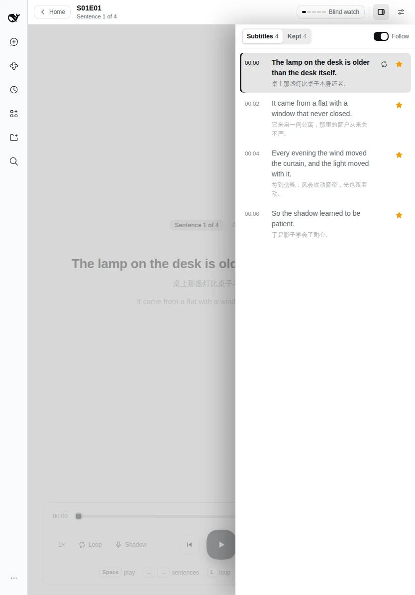

# Design

English | [简体中文](design.zh.md)

This document records the design reference behind the home, the practice view and the notes and steps drawers, and how the page follows the host's theme. Read it before changing proportions, colour or the narrow-screen layout.

## The Figma file is the reference for proportions and hierarchy

The layout, colours and interaction of the home, the practice view and the notes and steps drawers are drafted in Figma: [LinguaLab redesign](https://www.figma.com/design/kdmcHGX1TcLPj84v7rg1xY). The frames are `Practice / Light` and `Practice / Dark`, `Home / Light` and `Home / Dark`, `Notes / Light` and `Five steps / Light`.

The file is the reference for proportions and hierarchy, not for values: it hardcodes hex colours and the Inter font, while the page reads the host's `--dsw-alias-*` tokens and font so it follows the theme. A theme chosen in the settings overrides those same tokens on the page's root element and nowhere else.

## On a narrow screen the column covers the stage

The right column becomes a drawer instead of a column beside the stage:

