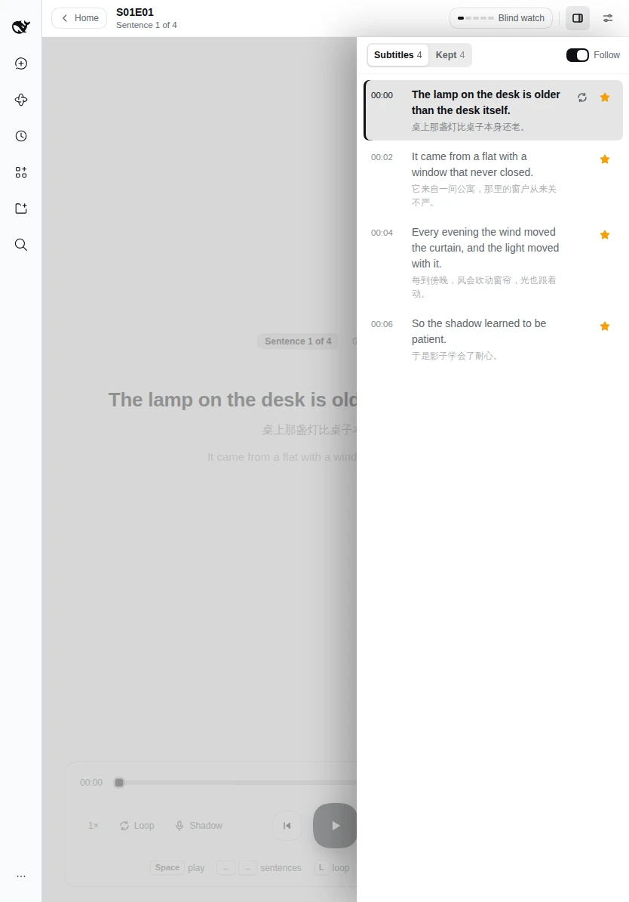

# 设计稿

[English](design.md) | 简体中文

这份文档记录首页、练习页、笔记抽屉和五步法抽屉背后的设计参考，也说明页面如何跟随宿主主题。改比例、配色或窄屏布局之前先读它。

## 比例和层级看 Figma 稿

首页、练习页、笔记抽屉和五步法抽屉的布局、配色和交互，先在 Figma 里出了设计稿：[LinguaLab redesign](https://www.figma.com/design/kdmcHGX1TcLPj84v7rg1xY)。画板有 `Practice / Light` 与 `Practice / Dark`、`Home / Light` 与 `Home / Dark`、`Notes / Light` 和 `Five steps / Light`。

这份设计稿用于参考比例和层级，不用来取具体数值：稿里写死了十六进制色值和 Inter 字体，而页面读取宿主提供的 `--dsw-alias-*` 令牌和字体，所以会跟着主题走。设置里选的主题只覆盖页面根元素上的这些令牌，页面之外不受影响。

## 窄屏时右栏盖在舞台上

右栏不再是舞台旁边的一列，而是变成盖在舞台上的抽屉：

